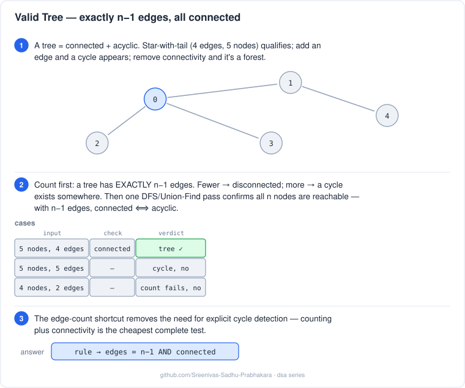

# Graph Valid Tree

> NeetCode 150 · Graphs · Blind 75 — a tree is exactly "n−1 edges + connected"; check the count first and one DFS settles the rest. Go, stdlib only, tested.

## Problem

Do n nodes and a list of undirected edges form a tree — connected and acyclic?

## Approach

The graph-theory fact doing the work: for a graph on n nodes, *any two* of {connected, acyclic, has n−1 edges} imply the third. So verify the cheapest pair: count edges (reject unless exactly n−1 — more guarantees a cycle, fewer guarantees disconnection), then one DFS from node 0 counting reachable nodes. Reaching all n proves connectivity, and with the edge count already fixed, acyclicity comes free — no parent-tracking cycle detection needed (contrast dsa-156, which must detect cycles without an edge-count promise). The duplicate-edge test shows why the count alone isn't enough.

**Complexity:** O(n + e) time, O(n) space.

## Visual walkthrough

Read the picture top to bottom — each numbered frame is one moment of the algorithm
running on this repo's test example.

## Run

    go test ./...   # verify
    go run .        # demo

---

Part of a 275-repo DSA series in Go — Striver's SDE Sheet (dsa-001–191) plus the NeetCode 150 / Blind 75 additions (dsa-192–275), stdlib only, every solution tested. Browse: [`dsa-*` repos](https://github.com/Sreenivas-Sadhu-Prabhakara?tab=repositories&q=dsa-&type=source).
